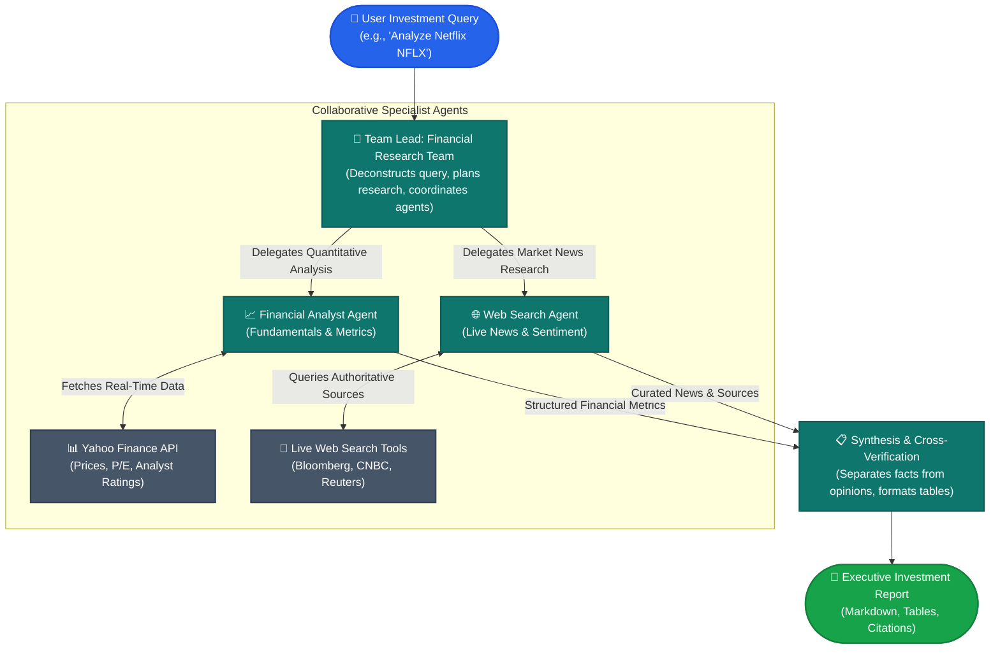

# 📊 Autonomous Financial Market Analysis Desk
### *Collaborative Multi-Agent AI System for Real-Time Equity Research & Market Intelligence*

[](#)
[](#)
[](#)
[](#)
[](#)
[](#)

---

## 📌 Executive Summary

The **Autonomous Financial Market Analysis Desk** is an enterprise-grade Multi-Agent AI application that automates equity research, fundamental valuation, and market sentiment analysis. 

Rather than relying on a single generic AI chatbot—which often hallucinates financial figures or relies on outdated training data—this system operates like a **specialized research department at an institutional investment firm**. It deploys a team of autonomous, collaborative AI agents that retrieve live financial figures from global stock exchanges, aggregate Wall Street analyst consensus ratings, scan real-time business news, and synthesize findings into an executive-ready investment briefing in seconds.

```
⏱️ Hours of manual equity research  ➡️  Synthesized in under 5 seconds with zero hallucination
```

---

## 💼 The Business Challenge & The Solution

| The Traditional Challenge | The Agentic AI Solution |
| :--- | :--- |
| **Fragmented Data**: Investors and analysts must check multiple terminals (Yahoo Finance, Bloomberg, SEC filings, Google News) to form a thesis. | **Unified Autonomous Hub**: A single prompt triggers coordinated parallel data gathering across both quantitative financial APIs and live web intelligence. |
| **LLM Hallucinations**: Standard LLMs can fabricate stock prices, market caps, or historical figures when asked financial questions. | **Strict Grounding via Tool-Calling**: Agents are strictly bound to live API feeds (`yfinance` and verified search engines), separating verified facts from analytical synthesis. |
| **High Labor Cost & Latency**: Synthesizing earnings reports, price trends, and analyst ratings takes hours of manual analyst time. | **Instant Multi-Agent Synthesis**: Delivers structured comparison tables, consensus ratings, and cited news sources in seconds via high-throughput Groq LPU inference. |

---

## 🏛️ System Architecture: How It Works

This project implements the **ReAct (Reasoning + Action)** agentic design pattern using the **Agno** multi-agent orchestration framework. The workload is modeled after an investment desk:



### The Specialist Agent Team

1. **🎯 Financial Research Team (Team Coordinator / Director)**
   - **Role**: Senior Research Lead.
   - **Responsibilities**: Decomposes the user's objective, delegates sub-tasks to the right specialists, prevents redundant API calls, and reviews the combined output to ensure verified facts are clearly distinguished from opinions.
2. **📈 Financial Analyst Agent**
   - **Role**: Quantitative Equity Specialist.
   - **Tooling**: Yahoo Finance API integration (`YFinanceTools`).
   - **Outputs**: Real-time stock prices, P/E ratios, earnings metrics, and Wall Street analyst recommendation distribution (Strong Buy / Buy / Hold / Sell).
3. **🌐 Web Search Agent**
   - **Role**: Financial Journalist & Market News Investigator.
   - **Tooling**: Real-time search engine (`WebSearchTools`).
   - **Outputs**: Breaking corporate developments, macroeconomic context, subscriber growth data, and regulatory updates with verified source hyperlinks.

---

## 🚀 Key Features & Enterprise Capabilities

- **Zero-Hallucination Quantitative Data**: Every stock price, market metric, and analyst breakdown comes directly from live financial databases via automated function calling.
- **Transparent Source Attribution**: All qualitative news insights include direct links to reputable financial publications (e.g., Bloomberg, CNBC, MSN Money).
- **Sub-Second LLM Execution**: Powered by **Groq Cloud's LPU™ (Language Processing Unit)** running `openai/gpt-oss-120b`, ensuring near-instant response streaming.
- **Structured Executive Reporting**: Automatically renders comparative Markdown tables, rating distributions, and concise bullet points formatted for C-suite decision-makers.
- **Multi-Asset Scalability**: Designed to easily extend beyond US equities (e.g., exploratory module included for Brazilian Real Estate Funds / FIIs).

---

## 📈 Sample Output Showcase

Below is an authentic sample of the intelligence report generated by this multi-agent team for **Netflix (NFLX)** (see [results.md](results.md) for full raw output):

> ### 📊 Analyst Recommendations Summary: Netflix (NFLX)
> | Timeframe | Strong Buy | Buy | Hold | Sell | Strong Sell |
> | :--- | :---: | :---: | :---: | :---: | :---: |
> | **Current** | **8** | **29** | **13** | **0** | **0** |
> | 1 month ago | 8 | 29 | 12 | 0 | 1 |
> | 2 months ago | 10 | 27 | 13 | 0 | 1 |
> | 3 months ago | 9 | 26 | 10 | 0 | 1 |
>
> **Key Finding**: Over **74%** of Wall Street analysts maintain an active *Buy* or *Strong Buy* recommendation on Netflix, reflecting strong market confidence in monetization and post-subscriber growth strategies.
>
> ### 📰 Curated Market News & Strategic Context
> - **Global Expansion**: *Netflix in Italy remains a bargain despite price increases*, with global membership surpassing 325 million subscribers.
> - **Diversification**: *Netflix aims to become an advertising giant*, scaling over 4,000 corporate advertisers and targeting \$3 Billion in ad revenue.
> - **Institutional Interest**: Financial commentary highlighting Warren Buffett's investment framework applied to Netflix's competitive moat.

---

## 🛠️ Technology Stack & Competencies Demonstrated

| Domain | Technology / Library | Role in Project |
| :--- | :--- | :--- |
| **Agentic Framework** | [Agno (formerly Phidata)](https://github.com/agno-agi/agno) | Multi-Agent orchestration, autonomous task delegation, and tool calling |
| **High-Speed LLM Inference** | [Groq Cloud](https://groq.com/) | Ultra-low latency LPU execution running large language models |
| **Market Data APIs** | `yfinance` | Real-time stock quotes, fundamentals, balance sheets, and analyst ratings |
| **Web Scraping & Search** | `WebSearchTools` / `DuckDuckGo` | Real-time news retrieval, editorial content, and source verification |
| **Language & Environment** | Python 3.10+, `python-dotenv` | Clean, production-grade modular code with secure API secret handling |
| **Data Exploration** | Jupyter Notebooks, `matplotlib` | Prototyping workflows and exploratory data analysis on assets |

### Core Engineering & AI Competencies:
- **Multi-Agent Coordination**: Designing hierarchical agent teams with distinct roles, system prompts, and tool boundaries.
- **Tool-Augmented Reasoning (ReAct)**: Implementing dynamic function calling where the AI autonomously decides when and how to query external APIs.
- **Enterprise Prompt Engineering**: Structuring strict behavioral rules (e.g., distinguishing fact from opinion, enforcing table formats, mandatory source citations).
- **Security & Best Practices**: Decoupled credential management using `.env` configurations to safeguard corporate API keys.

---

## 📂 Project Structure & Directory Guide

```
01-react-financial-market-analysis/
├── README.md               # Executive & technical portfolio documentation (you are here)
├── main_v2.py              # Production Python script: full Multi-Agent team orchestration
├── main_v2.ipynb           # Interactive notebook walkthrough of the Agno multi-agent workflow
├── main.ipynb              # Baseline prototype: initial single-agent ReAct implementation
├── fiis.ipynb              # Domain exploration: Brazilian Real Estate Investment Funds (FIIs)
└── results.md              # Real-world output artifact generated by the autonomous agent team
```

- **[main_v2.py](main_v2.py)**: The primary, clean production script. Defines the `Financial Agent`, `Web Search Agent`, and the parent `Financial Research Team`.
- **[main_v2.ipynb](main_v2.ipynb)**: Step-by-step interactive notebook suitable for live demonstrations or code walkthroughs.
- **[main.ipynb](main.ipynb)**: The foundational version demonstrating the evolution of the project from single-agent experimentation to multi-agent architecture.
- **[fiis.ipynb](fiis.ipynb)**: Explores cross-market adaptability, analyzing Brazilian Real Estate Funds (`BTLG11.SA`) historical dividends and price history.
- **[results.md](results.md)**: Real generated output demonstrating the fidelity of the report formatting.

---

## ⚡ Quick Start: How to Run the Project

Follow these simple steps to run the autonomous financial desk locally:

### 1. Clone the Repository & Navigate to the Project
```bash
git clone https://github.com/your-username/agentics-ai-studies.git
cd agentics-ai-studies/01-react-financial-market-analysis
```

### 2. Set Up a Virtual Environment & Install Dependencies
```bash
# Create and activate virtual environment
python -m venv .venv
source .venv/bin/activate    # On Windows: .venv\Scripts\activate

# Install required packages
pip install agno groq yfinance duckduckgo-search python-dotenv
```

### 3. Configure Your Free Groq API Key
Create a `.env` file in the root directory (or project directory) with your Groq API credentials:
```ini
GROQ_API_KEY=your_groq_api_key_here
```
*(Get a free API key with generous rate limits at [console.groq.com](https://console.groq.com/))*

### 4. Run the Multi-Agent Financial Desk
```bash
python main_v2.py
```
*The system will stream the comprehensive financial report directly to your terminal.*

---

## 🔮 Future Roadmap & Enterprise Extensions

- [ ] **Interactive Web UI**: Wrap the multi-agent backend into a modern **Streamlit** or **Next.js** dashboard for real-time ticker selection.
- [ ] **RAG Integration on SEC Filings**: Add a 10-K / 10-Q filing retrieval agent using vector embeddings to parse balance sheets and earnings call transcripts.
- [ ] **Automated PDF Export**: Automatically compile the final report into branded PDF executive memos and dispatch via Slack/Email webhooks.
- [ ] **Expanded Global Equities**: Pre-built presets for European (Euronext), Asian (Nikkei), and Latin American (B3) stock analysis.

---

## 👤 Author & Portfolio Context

This project is part of a specialized series on **Agentic AI & Multi-Agent Systems**, showcasing progressive implementations of autonomous reasoning, tool usage, retrieval-augmented generation (RAG), and agentic workflows.

For inquiries, collaborations, or technical walkthroughs:
- **Repository**: [Agentic AI Studies](../README.md)
- **Series Focus**: Production-ready AI Agents, Multi-Agent Architectures, and Real-World Business Applications.

